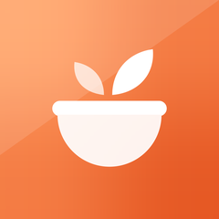
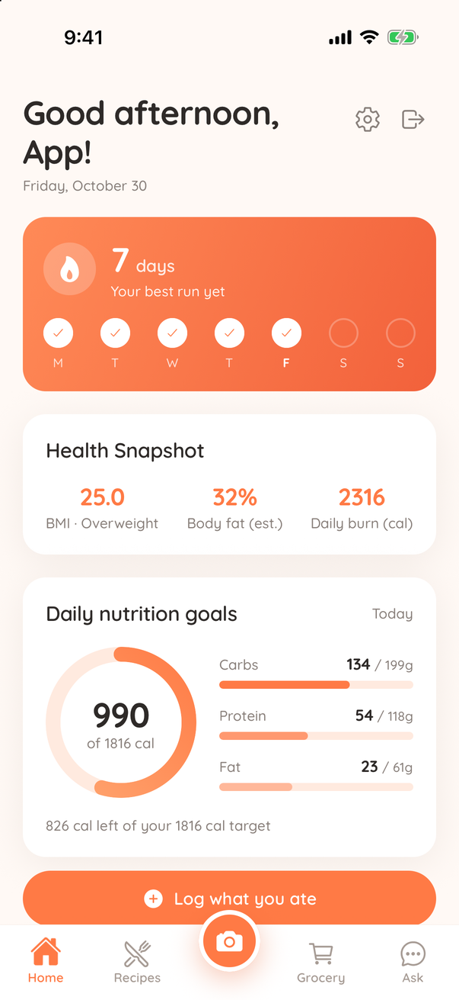
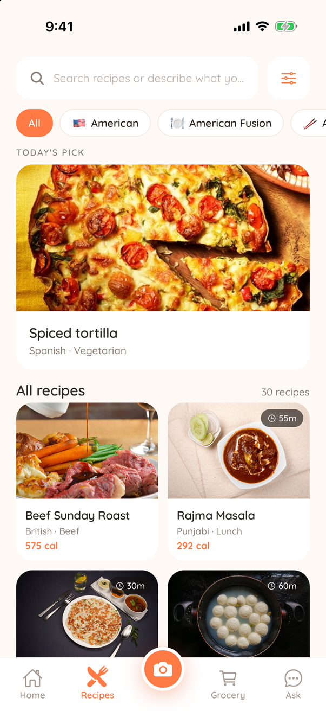
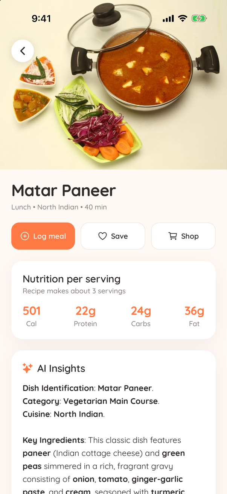
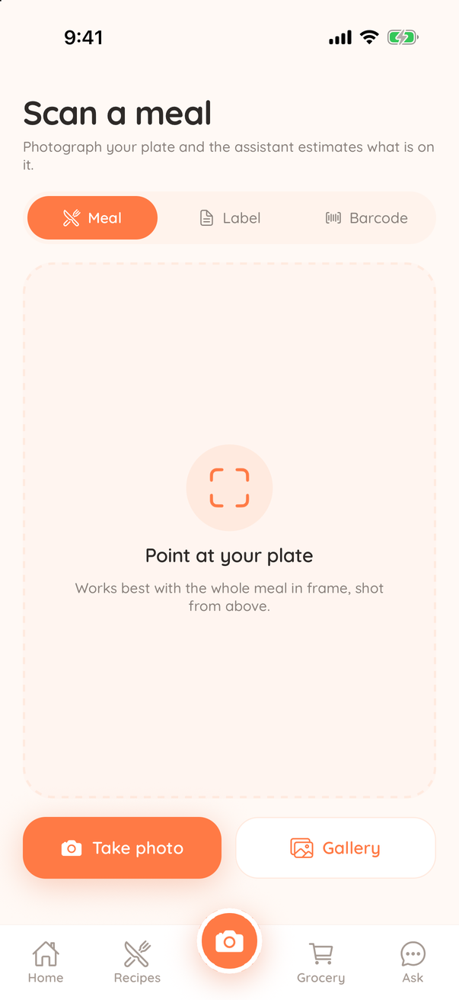
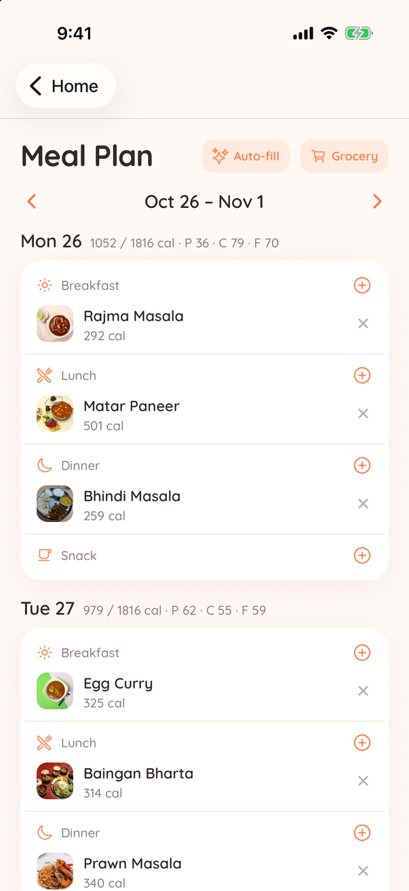
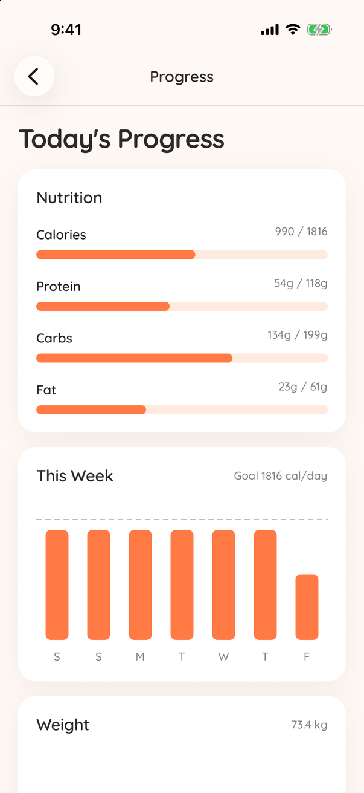
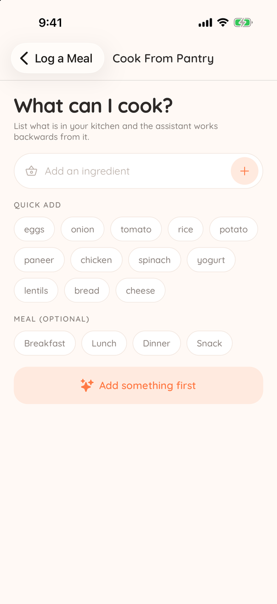
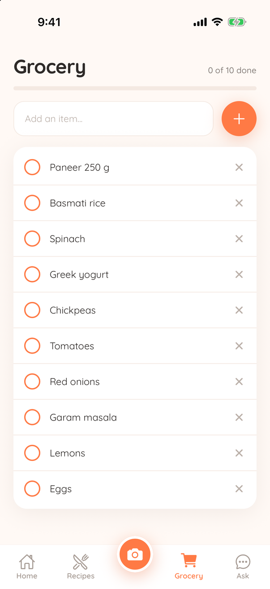
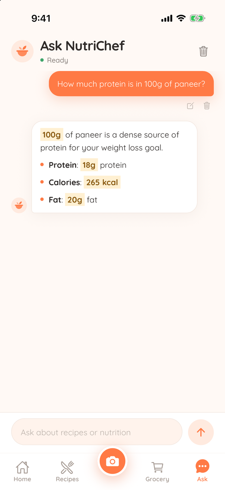

<div align="center">



# NutriChef

**A recipe and nutrition app that learns what you like to eat.**

Snap a meal, cook from what's in your pantry, plan the week, and track your
macros. Calories come from a real nutrition pipeline (USDA + the Indian Nutrient
Databank), not from guesses, and Indian meals (idli, dosa, dal, roti, biryani…) are
first-class.


</div>

---

## Screenshots

<table>
  <tr>
    <td align="center"><br /><sub><b>Home</b>: streak, health snapshot, daily macros</sub></td>
    <td align="center"><br /><sub><b>Recipes</b>: search, cuisines, today's pick</sub></td>
    <td align="center"><br /><sub><b>Recipe</b>: per-serving macros + AI insights</sub></td>
  </tr>
  <tr>
    <td align="center"><br /><sub><b>Scan</b>: meal photo, nutrition label, barcode</sub></td>
    <td align="center"><br /><sub><b>Meal Plan</b>: weekly plan with auto-fill</sub></td>
    <td align="center"><br /><sub><b>Progress</b>: macros, weekly calories, weight</sub></td>
  </tr>
  <tr>
    <td align="center"><br /><sub><b>Pantry</b>: "what can I cook?"</sub></td>
    <td align="center"><br /><sub><b>Grocery</b>: list filled from recipes and plans</sub></td>
    <td align="center"><br /><sub><b>Ask</b>: food and nutrition assistant</sub></td>
  </tr>
</table>

## Features

| | |
| --- | --- |
| 📸 **Scan a meal** | Photograph your plate. A vision model names each item with its grams (and pieces: "3 idli"), then NutriChef's own food tables price every item they know, so the calories don't depend on the model's arithmetic. |
| 🏷️ **Nutrition labels** | Read **on the phone** with Apple's built-in text recognition: free, offline, no AI permission. Handles US panels and Indian/FSSAI "per 100 g" tables, kJ and decimal commas; pick how many grams you ate. Falls back to the vision model only when the text doesn't add up. **Barcodes** via Open Food Facts. |
| 🍛 **Indian food** | ~200 prepared dishes (tiffins, curries, rice, breads, snacks, sweets, drinks) and household units: "3 idli", "1 katori dal", "1 plate biryani", "dosa x2". 80 curated Indian recipes with declared servings; the **Indian** chip covers every regional cuisine. |
| 🥘 **Cook from pantry** | List what's in your kitchen and get dishes ranked by how little is missing. Missing items go straight to the grocery list. |
| 🛒 **Shop a recipe** | Tap **Shop** on a recipe, mark what you already have (salt and spices start ticked), and only the missing ingredients go on the list with their quantities. Each item opens **Blinkit, Zepto or Instamart** search in their app (universal links), remembering your last store. None of them has a public cart API, so it's one search per item. |
| 📅 **Meal planning** | A weekly plan with one-tap auto-fill from your taste profile, then the whole week's ingredients sent to the grocery list. |
| 📊 **Tracking** | Typed meal logging ("2 eggs, toast, handful of almonds"), portion-aware recipe logging (½ to 3 servings), water, weight, streaks and progress charts. |
| 🎯 **Adaptive goals** | After a few weeks of logs and weigh-ins, NutriChef measures your actual daily energy use (TDEE) and recalibrates your calorie target. |
| 🧠 **Taste engine** | Personalised suggestions with **no LLM**: implicit feedback (views, logs, favourites, dislikes…) is folded into a time-decayed profile, and every suggestion comes with the reasons it was picked. |
| 💬 **Ask NutriChef** | A chat assistant that only talks about food and nutrition, plus a weekly coach that reviews your real logs. |
| 🔔 **Smart reminders** | Local notifications scheduled from your own typical meal times. No push server needed. |
| 📴 **Offline-friendly** | The query cache is saved on the device, so the app opens with your plan and recipes even when the server can't be reached. |

### Nutrition you can trust

Every calorie runs through one pipeline: ingredient → grams → per-100 g macros →
per serving. It uses a curated static table first, then **USDA FoodData Central**,
and caches every lookup in Postgres. Indian dishes come from the
[Indian Nutrient Databank](https://github.com/lindsayjaacks/Indian-Nutrient-Databank-INDB-)
(2024) where its values are plausible. Along the way it:

- understands food-specific units: a stick of butter is 113 g, a stick of cinnamon 3 g
- uses each food's density for volumes: a cup of flour is 127 g, a cup of milk 247 g
- converts dry grains and pulses with cooked yields
- matches whole words, so "eggplant" never counts as egg and "pineapple" never as apple
- weighs meat raw, as recipes list it, so a curry isn't credited with cooked-meat protein
- counts water the grains absorb (minus evaporation), only ~15% of a frying pot of oil,
  and half the syrup of a soaked sweet
- uses the recipe's declared servings, else estimates them from the weight of the finished dish

## Tech stack

```
apps/mobile       Expo SDK 54 · React Native 0.81 · React Navigation 7 · TanStack Query 5
apps/api          Fastify 5 · Prisma 5 · PostgreSQL (pg_trgm search) · zod
packages/shared   zod schemas + pure nutrition maths, the single API ↔ app contract
```

- **Auth**: scrypt password hashing, 15-minute HMAC access tokens, and 30-day
  rotating refresh tokens (stored only as SHA-256 hashes; reusing an old one
  revokes the whole token family).
- **AI**: a pluggable provider chain (Ollama, Z.ai, Gemini, OpenAI, Anthropic,
  Mistral, Kimi, OpenRouter) set by `AI_PROVIDER_ORDER`. The first provider that
  succeeds wins. Image requests only go to providers that support vision. The
  default runs on **Ollama's free cloud tier**, so you don't need an API key or a
  credit card.
- **Recipes**: [TheMealDB](https://www.themealdb.com) plus a curated Indian
  collection. When a search finds nothing, AI generates the recipe.
- **Security**: helmet, rate limits (tighter on AI routes), body size limits,
  every input bounded, and a single error envelope.
- **App Store ready**: in-app account deletion, privacy policy and terms served
  at `/privacy` and `/terms`, explicit consent before personal data reaches an AI
  provider, a privacy manifest, and "not medical advice" notices.

## Getting started

### Prerequisites

- Node.js 20+ and npm 10+
- PostgreSQL 14+ (installed locally, or `docker compose up -d` using the included compose file)
- Optional: [Ollama](https://ollama.com) (`ollama signin` once) for the AI features

### 1. Install and configure

```bash
git clone https://github.com/<vikramballa>/nutrichef.git
cd nutrichef
npm install                                  # also builds packages/shared + prisma generate
cp .env.example .env                         # set DATABASE_URL, AUTH_SECRET, FDC_API_KEY…
cp apps/mobile/.env.example apps/mobile/.env # set EXPO_PUBLIC_API_URL
```

Key environment variables (the full documented list is in [`.env.example`](.env.example)):

| Variable | Purpose |
| --- | --- |
| `DATABASE_URL` | Postgres connection string (URL-encode special characters in the password) |
| `AUTH_SECRET` | Token signing secret. Must be 32+ characters in production (`openssl rand -base64 48`) |
| `FDC_API_KEY` | Free [USDA FoodData Central key](https://fdc.nal.usda.gov/api-key-signup/). Strongly recommended: the shared `DEMO_KEY` is often rate-limited |
| `AI_PROVIDER_ORDER` | AI fallback order. Every provider is optional |
| `OLLAMA_MODEL` / `OLLAMA_VISION_MODEL` | Text and vision models. The defaults are free Ollama cloud models |
| `SUPPORT_EMAIL` | Contact address shown in the privacy policy and terms |

### 2. Set up the database

```bash
npm run db:setup          # apply migrations + seed demo data
npm run db:seed:indian -w apps/api   # 80 curated Indian recipes (re-run safely; recomputes nutrition)
npm run db:import         # optional: bulk-import recipes from TheMealDB
```

### 3. Run

```bash
npm run dev:api           # API with hot reload, http://localhost:4000
npm run dev:mobile        # Expo dev server: press i / a, or scan the QR code
```

Check it's running: `curl localhost:4000/health` → `{"ok":true,"db":true,"aiProviders":[...]}`

Set `EXPO_PUBLIC_API_URL` in `apps/mobile/.env` to match where the app runs:

| Where the app runs | `EXPO_PUBLIC_API_URL` |
| --- | --- |
| iOS simulator | `http://localhost:4000/api/v1` |
| Android emulator | `http://10.0.2.2:4000/api/v1` |
| Physical device (same Wi-Fi) | `http://<your-computer-LAN-IP>:4000/api/v1` |

> The meal scanner needs a vision-capable provider. Without one, `/vision/*`
> returns 503 and the Scan tab says so plainly. The rest of the app keeps working.

> On-device label reading is a local native module (`apps/mobile/modules/label-ocr`),
> so it needs a development or release build (`npx expo prebuild -p ios`). In Expo Go
> the label scanner falls back to the vision model.

## Development

```bash
npm test                                    # vitest across all workspaces (DB-free)
npm run typecheck                           # API
npx tsc --noEmit -p apps/mobile/tsconfig.json
npm run build                               # shared → api (prisma generate + tsc)
```

After editing `packages/shared`, run `npm run build -w packages/shared`. Both apps
consume its built `dist/`.

### Database workflows

```bash
cd apps/api && npx prisma migrate dev --name <change>   # new migration after editing schema.prisma
cd apps/api && npx prisma migrate deploy                # apply migrations (production-safe)
npm run db:backfill-nutrition -w apps/api               # recompute nutrition after a table change
npm run db:seed:reviewer -w apps/api                    # App Review demo account (REVIEW_EMAIL / REVIEW_PASSWORD)
```

Always use migrations. **Never `prisma db push`**.

### Brand assets

The icon, Android adaptive foreground, splash mark and favicon are all rendered
from the same geometry by `apps/mobile/scripts/generate_icons.py` (needs Pillow).

## Project structure

```
.
├── apps/
│   ├── api/
│   │   ├── prisma/            schema, migrations, seed + import scripts
│   │   ├── recipe-photos/     bundled recipe images, served by the API
│   │   ├── src/
│   │   │   ├── routes/        HTTP only: validate → service → DTO
│   │   │   ├── services/      logic: taste engine, nutrition, AI chain, adaptive goals…
│   │   │   └── lib/           prisma, auth, http helpers
│   │   └── test/              vitest unit tests (pure, no DB)
│   └── mobile/
│       ├── src/
│       │   ├── screens/       one file per screen
│       │   ├── hooks/         one react-query hook per domain
│       │   ├── api/           fetch client with transparent token refresh
│       │   ├── notifications/ local reminder scheduling
│       │   └── theme/         colours, type, motion vocabulary
│       ├── modules/label-ocr/ on-device text recognition (Apple Vision)
│       └── plugins/           Expo config plugins
├── packages/shared/           zod schemas + nutrition maths (API ↔ app contract)
├── docs/screenshots/          README images
└── .github/workflows/ci.yml   install, typecheck, test on every push / PR
```

## Production (API)

```bash
npm run build -w apps/api && npm start -w apps/api     # node dist/server.js
docker build -t nutrichef-api apps/api                 # or as a container
```

In production `AUTH_SECRET` must be a real secret (32+ characters, not the
placeholder), CORS is closed by default, and `/debug/taste` is not registered.

## Disclaimer

NutriChef gives general nutrition information and estimates. It is not medical
advice. Talk to your doctor or a registered dietitian before making changes to
your diet, especially if you have a medical condition.
